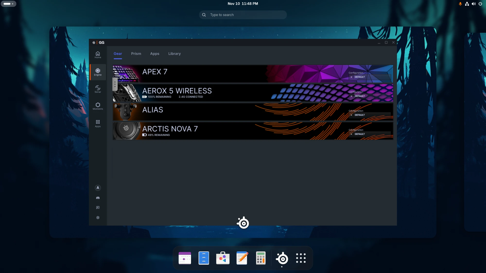

# SteelSeries GG for Linux

gg-linux runs SteelSeries GG on Linux: the Engine (device settings, key
bindings, macros, Prism lighting, GameSense), Sonar, Moments and QuickSet,
in GG's own interface. It runs **your own copy** of the official GG client
on Linux Electron and replaces the Windows services behind it.

gg-linux is an unofficial project, not affiliated with or endorsed by
SteelSeries. Nothing from SteelSeries' installer is in this repository: the
setup script downloads the installer from steelseries.com and unpacks it on
your machine.

## How it works

- `ggd` (Go) serves the APIs the client talks to: the GG core, Engine,
  PrismSync, GameSense, Sonar and Moments. It talks to devices over hidraw,
  runs Sonar's audio on PipeWire, and puts GG's icon in the tray.
- `internal/devicert` runs SteelSeries' device specifications (the Engine's
  device DSL) on [golisp](https://github.com/steelseries/golisp), the
  interpreter the Engine embeds. All 606 device declarations in GG 123's
  489 specification files load.
- `client/linux` is the Electron bootstrap: it starts `ggd`, stands in for
  the client's handful of Windows-only calls, and loads the original
  client.
- `gg-setup` unpacks the client, device specifications, database
  migrations and images from the installer, and recovers the key for the
  device specifications from that installer's `SteelSeriesEngine.exe`.

## Install

    git clone https://github.com/TheWoomy27/steelseries-gg-linux.git
    cd steelseries-gg-linux
    ./setup.sh

`setup.sh` installs gg-linux for your user:

1. Checks what gg-linux needs and, on Arch-based systems, offers to install
   what is missing with pacman.
2. Downloads SteelSeries GG's Windows installer from
   <https://steelseries.com/gg/downloads/gg/latest/windows> into
   `~/.cache/gg-linux` (about 430 MB). `--installer PATH` uses one you
   already have instead.
3. Builds gg-linux, imports the installer and runs `packaging/install.sh`.
4. Offers to install the udev rule for device access (sudo), then enables
   and starts ggd.

`--yes` answers its questions, and `--no-udev` / `--no-service` skip the
last two steps. Then open SteelSeries GG from your application menu.

Needed: Go, gcc and the readline headers (for golisp), 7z, curl, and
Electron 37 or newer (`GG_LINUX_ELECTRON` picks one that is not on your
PATH).

Recommended:

| Package | For |
| --- | --- |
| PipeWire, WirePlumber, `pactl` | Sonar, Prism's audio effects, Moments audio |
| ffmpeg, gpu-screen-recorder | Moments |
| wl-clipboard | text macros, sharing clips |
| xdg-utils | opening links and files |
| DeepFilterNet's LADSPA plugin, LSP plugins | Sonar's mic and chat effects |
| PipeWire's SOFA plugin, libmysofa | Sonar's spatial audio |

Recording macros reads every keyboard and mouse through `/dev/input`, so
your user has to be in the `input` group for it.

### By hand

    go build -o bin/ ./cmd/...
    bin/gg-setup SteelSeriesGG<version>Setup.exe      # import into ~/.local/share/steelseries-gg
    packaging/install.sh                               # install for your user
    sudo cp packaging/70-steelseries-gg.rules /etc/udev/rules.d/   # device access
    systemctl --user enable --now steelseries-ggd.service          # start ggd at login

`install.sh` puts `ggd`, `ggctl`, `gg-setup` and the `steelseries-gg`
launcher in `~/.local/bin` (`PREFIX` changes that), adds a desktop entry
with GG's icon, and installs a systemd user service that starts `ggd` with
your graphical session. The launcher starts `ggd` itself when it is not
running.

### Updating

Pull and run `./setup.sh` again. It downloads a newer GG when there is one,
imports only when the installer changed, rebuilds and restarts ggd.

### Uninstalling

    systemctl --user disable --now steelseries-ggd.service
    rm ~/.local/bin/{ggd,ggctl,gg-setup,steelseries-gg}
    rm -r ~/.local/lib/steelseries-gg
    rm ~/.local/share/applications/steelseries-gg.desktop ~/.config/systemd/user/steelseries-ggd.service
    rm ~/.local/share/icons/hicolor/*/apps/steelseries-gg.png
    sudo rm /etc/udev/rules.d/70-steelseries-gg.rules

GG's data (configurations, Sonar and Moments settings, the imported
client) is in `~/.local/share/steelseries-gg`, and the downloaded installer
in `~/.cache/gg-linux`; remove them too for a clean slate. Clips stay in
`~/Videos/SteelSeries Moments`. ggd also writes a `coreProps.json` into
Wine and Proton prefixes, under
`drive_c/ProgramData/SteelSeries/SteelSeries Engine 3`.

## What works

### Devices and configurations

- The home page, the Engine's gear page and each device's configuration
  pages, with the Engine's configuration migrations.
- Deploying configurations: settings, key mappings and the Apex keyboards'
  meta layer, re-applied when a device connects. A wireless mouse that
  misses settings while asleep gets them when it wakes. gg-linux writes
  nothing to a device until you change a setting in GG.
- Parametric EQ presets for headsets, and the Arctis Nova 7 Gen 2's
  on-device EQ. With Sonar on, GG's Auto-Flatten EQ banner reports a
  headset EQ that stacks on Sonar's and flattens it when you ask.
- A wireless mouse plugged in by cable while its dongle is in.
- Battery levels, and a desktop notification when a device's battery runs
  low (where Windows GG shows an overlay), following GG's notification and
  low battery sound switches.
- The tray icon: open GG, switch each connected device's configuration,
  sub-apps' menus, and Exit, which stops ggd and the client.

### Key bindings and macros

A configuration's keys can be bound to macros, OS shortcuts, other keys,
launching an application, switching configurations, text macros, GameSense
game events and switching Engine apps (PrismSync, ImageSync, GameSense
games).

- Devices with onboard macro memory (the Apex 7, Apex Pro and Apex 9
  keyboards, the Prime mice) play macros themselves; they are written with
  the key mappings, in the format Windows GG uses.
- ggd runs the rest. A key bound that way sends a spare key code the
  desktop ignores (unless the binding passes the input through); ggd reads
  the device's reports and plays the binding through a virtual keyboard
  and mouse on `/dev/uinput`. Text macros are pasted from the clipboard, as
  Windows GG pastes them.
- Launch Application offers the desktop's applications, `.desktop` files,
  AppImages and shell scripts.
- GG's macro editor, Quick Record and shortcut settings record from
  `/dev/input`. ggd reads only while GG records, and never grabs the
  devices.

### Sonar

Sonar runs on PipeWire, in classic and streamer mode: the Game, Chat,
Media, Aux and Microphone channels with their EQ, volumes, ChatMix and
devices; per-app routing; samples; fallback devices; the Arctis Nova 7's
ChatMix dial; device volumes and level meters; ClearCast, noise reduction,
noise gate and the compressor; smart volume; and spatial audio (virtual 7.1
for headphones or speakers, with reverb). Echo canceling is offered while
Sonar plays to speakers of any brand, where Windows offers it for
SteelSeries Arena speakers only. Effects whose plugins are missing are left
out. [docs/sonar.md](docs/sonar.md) describes how each part maps to
PipeWire.

### Moments

The clip library, the editor (trim, 9:16 crop, texts, audio tracks,
screenshots, montages), exports and the settings pages.

- Capture is off until you turn it on. Then Moments keeps the last minutes
  of the game (or the desktop, in desktop mode) in a replay buffer in RAM,
  and its shortcut saves a clip in `~/Videos/SteelSeries Moments`, with the
  game sound, chat and microphone on separate tracks.
- Recording uses gpu-screen-recorder when it is installed (it encodes on
  the GPU and keeps sound and picture in sync), else wf-recorder on
  Wayland or ffmpeg on X11.
- On Hyprland, GG's Moments shortcuts (Alt+S saves a clip) are bound while
  capture is on, except keys your configuration already uses. On other
  desktops, bind a key to `ggctl moments clip`.
- Sharing: clips drag out of GG's share dialogs into Discord, browsers and
  file managers. Sharing to YouTube exports the clip into the Shared Clips
  folder, shows it in the file manager with its path on the clipboard, and
  opens YouTube's upload page; Windows GG uploads through SteelSeries'
  cloud instead.

On Wayland, Electron offers dragged files but cannot hand them over
(Chromium sends nothing for `text/uri-list`), so the launcher preloads a
small library, `packaging/dragfix.c`, that answers for it on GG's Wayland
connection.

### Prism

ggd renders PrismSync lighting and sends it to the devices made for it
(Apex 7, Alias, the Aerox 3 and 5 Wireless and others), which follow Prism
as soon as they connect. A device switched out of Prism gets its own
configuration's lighting back.

- Configurations, presets, the device canvas, and the Off, Single color,
  Breathe and Color shift effects on any selection of keys and zones.
- The idle layer and the reactive one (Line, Ripple and Fade on key
  presses). ggd reads key reports only while a configuration uses one of
  these layers.
- The Audio Visualizer, from the default output or the one picked in its
  menu, through PipeWire.
- Reflect, which copies the focused monitor through wlr-screencopy
  (Hyprland, sway and other wlroots compositors) at most 10 times a second,
  when the screen changes. It costs the compositor some CPU (Hyprland:
  about 10% of a core on a 2560x1440 monitor).
- On Hyprland, lighting dims or goes off while the monitors sleep, as each
  configuration's "When Monitor Sleeps" says.
- ImageSync plays a GIF on per-key keyboards, and GG's PrismSync switch
  turns Prism's lighting off and on.

GG's previews of the Audio Visualizer and Reflect use made-up sound and a
made-up picture.

### GameSense

- Lighting: games that use the GameSense SDK light keys and zones with
  their handlers, as the Windows Engine runs them (static, gradient and
  ranged colours, flashing, percent and count bars, context colours and
  22x6 bitmaps), drawn over Prism's lighting until the game stops or goes
  quiet for its timeout.
- Screens: games' screen handlers show on the Apex OLED (text, progress
  bars, GG's event icons and pictures), timed and repeated as on Windows.
  The Engine's own screen apps, Now Playing (from MPRIS players), System
  Stats and Clock, are in Engine > Apps.
- GG's Apps page lists the games, with their switch, and its GameSense
  page edits a game's effects per device.
- Native games find ggd through `SteelSeries Engine 3/coreProps.json` in
  the data folder. For Windows games under Proton or Wine, ggd writes that
  file into every prefix it finds: Steam's in each library (new ones as
  soon as Proton makes them), `~/.wine`, Lutris and umu prefixes in
  `~/Games`, Heroic's and Bottles'.

### QuickSet

A game profile is deployed while its game runs (Steam games by app id,
others by install folder) and Default comes back when it exits. Device
configurations and the Sonar Game preset follow the profile, and a game
with a Sonar preset gets a profile made from it. Profiles are off until
you turn them on in QuickSet. Wayland has no portable way to tell which
window is in front, so a running game counts as in front.

### Desktop integration

- On tiling compositors (Hyprland, sway), GG's secondary windows float at
  GG's size and the main window tiles. Hyprland ignores the minimize
  button.
- On machines with two kinds of GPU (an Intel iGPU and an NVIDIA card, say)
  the launcher points Chromium at the GPU driving the displays.
- GG's Auto-run setting enables or disables the ggd user service.

## Not supported

- SteelSeries account sign-in. GG runs signed in to a local profile (your
  Linux user), so Sonar and Moments open offline.
- Firmware updates, on purpose: gg-linux never flashes a device.
- GameSense vibration, cooldown timers (an effect of GG's older per-key
  lighting editor, for the Apex M750/M800, Apex 3 and MSI keyboards) and
  the Moments record toggle as a key binding.

## Tested hardware

Tested on Hyprland and GNOME (CachyOS) with an Apex 7, an Aerox 5 Wireless,
an Alias and an Arctis Nova 7 Gen 2, on Electron 37 and 39. Other devices
run on the same device specifications as on Windows and are expected to
work, but are untested. The Aerox 5's extra side buttons are read from
where that mouse reports them, so other mice's extra buttons may need work.

Reports from other devices and desktops are welcome: open an issue with
your device and the logs below.

## Troubleshooting

- ggd's log: `journalctl --user -u steelseries-ggd`, also in
  `~/.local/share/steelseries-gg/Logs/ggd.log`. `GG_LINUX_DEBUG=1` (or
  `ggd -v`) logs more.
- The client's log: `~/.local/share/steelseries-gg/Logs/client.log`.
- GG does not see a device: check the udev rule is installed, then replug
  the device.
- `ggctl` talks to devices directly: `ggctl devices`, `ggctl apis 1852`,
  `ggctl read 1852 read_battery_status`, `ggctl call 22a1 get_headset_status`.
  It also drives Moments in the running ggd: `ggctl moments clip` saves a
  clip, and `ggctl moments toggle|mic|desktop|status` switch capture, the
  microphone and desktop capture.

## Development

    go build ./... && go test ./...

Tests that need a desktop, devices or a private PipeWire are skipped unless
their environment variable is set; the comment above each test says which.
Sonar's PipeWire tests are described in [docs/sonar.md](docs/sonar.md#tests),
and `python3 packaging/dragfix_test.py` tests the drag fix.

To run a source checkout without installing, point the launcher at it:
`GG_LINUX_GGD=$PWD/bin/ggd GG_LINUX_BOOTSTRAP=$PWD/client/linux/bootstrap.js packaging/steelseries-gg`.

`tools/gorev` inspects stripped Go binaries, which is how the GG core,
Engine and PrismSync APIs were mapped; `tools/sonar-oracle` checks Sonar's
config upgrades against Sonar's own code.

## License

gg-linux is licensed under the GNU General Public License v3.0; see
[LICENSE](LICENSE). SteelSeries, GG, Sonar, Moments, Prism and GameSense
are trademarks of SteelSeries ApS. The GG client and device specifications
gg-linux runs are SteelSeries' and come from your own copy of their
installer.
